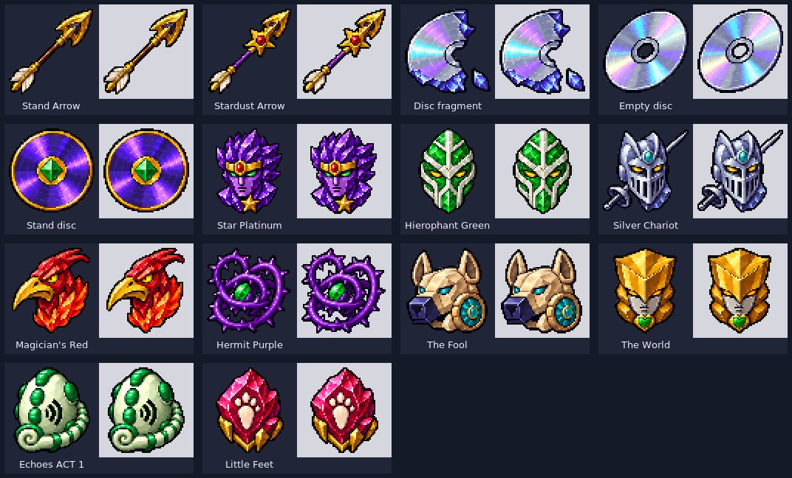

# Sprites de ítems — 0.13.1

Los **14 ítems** usan sprites propios de **64×64 píxeles RGBA**. Los núcleos se
reconocen por silueta y rasgos del Stand, además del color. El borde oscuro,
los reflejos desde arriba a la izquierda y el margen transparente son comunes.
Las flechas, los discos y sus fragmentos conservan familias visuales diferentes.



| Ítem | Motivo |
| --- | --- |
| `stand_arrow` | Flecha dorada con punta esculpida y asta marrón |
| `stardust_arrow` | Flecha con estrella, rubí y asta violeta |
| `stand_disc_fragment` | Media luna rota y esquirla iridiscente |
| `empty_stand_disc` | Disco plateado con agujero central transparente |
| `stand_disc` | Disco violeta, borde dorado y gema jade |
| `star_platinum_core` | Rostro violeta, diadema dorada, ojos verdes y estrella |
| `hierophant_green_core` | Máscara blanca segmentada, trama verde y ojos amarillos |
| `silver_chariot_core` | Yelmo plateado y estoque |
| `magicians_red_core` | Cabeza aviar roja, pico dorado y llamas |
| `hermit_purple_core` | Espiral asimétrica de lianas moradas con espinas |
| `the_fool_core` | Cabeza canina mecánica de arena y rueda turquesa |
| `the_world_core` | Casco dorado, cara gris y corazón verde |
| `echoes_act_1_core` | Huevo verde marfil, cola y ondas sonoras |
| `little_feet_core` | Cristal magenta con huella marfil |

El atlas maestro [source-atlas.png](source-atlas.png) es arte nuevo generado con
asistencia de IA mediante OpenAI image generation. El [brief](source-brief.md)
documenta la dirección y la corrección de márgenes. No se importaron sprites de
otros mods ni fotogramas. El arte del proyecto se distribuye bajo MIT; los
personajes y la franquicia conservan los derechos de sus titulares.

## Exportación reproducible

Requiere Python 3, Pillow e **ImageMagick 7**:

```sh
python art/items/build_sprites.py
```

El exportador recorta las celdas del atlas, ajusta cada silueta a un máximo de
58×58 con vecino más próximo y la centra en 64×64. La transparencia se convierte
a 0/255 para evitar halos y caras semitransparentes al sostener el objeto. El
agujero central del disco vacío permanece abierto. No se necesita volver a
invocar el generador de imágenes ni conexión de red.

Los 14 SVG contienen píxeles editables como rectángulos, sin fuentes ni imágenes
externas incrustadas. Son exportaciones de los mismos píxeles usados en el juego;
para reproducir los PNG se conserva el atlas maestro, la disposición y la versión
del exportador en [asset-provenance.json](asset-provenance.json). Si editas un SVG
para un cambio nuevo, exporta sus píxeles al atlas maestro antes de regenerar.

Este es el único generador que escribe las texturas de inventario. Los generadores
de entidades de `art/part_three` y `art/hierophant_green` conservan sus modelos,
atlas y animaciones, y remiten a este manifiesto para los ítems. El JAR incluye
`META-INF/jojosmod/item-sprites-provenance.json`, con hash de fuente y de cada PNG.
Los modelos de ítem continúan usando `minecraft:item/generated`.

La [prueba visual](../../docs/playtest-0.13.1.md) cubre inventario, mano y suelo.
