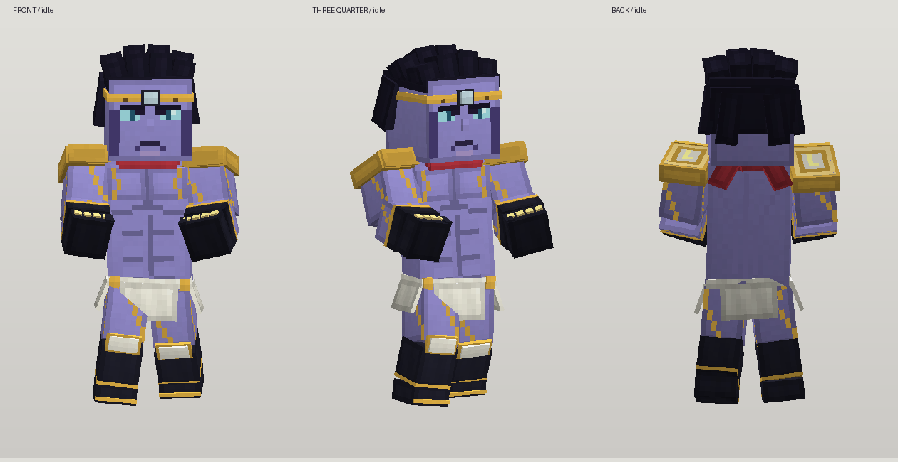

# Star Platinum sobre base de jugador — 0.9.1

La geometría utiliza las proporciones del jugador clásico: cabeza 8×8×8, torso
continuo 8×12×4 y extremidades 4×12×4. Sobre esa base se construyen los detalles
de Star Platinum, con textura, UV y animaciones del proyecto. Roundabout sirve de
referencia para la adaptación al estilo de Minecraft. No se cargan sus modelos,
atlas, poses o keyframes en el generador. Star Platinum es un personaje de Hirohiko Araki;
la autoría de estos recursos corresponde a su representación y ejecución técnica.

## Fuentes editables

La [guía de Blockbench y GeckoLib](../../docs/blockbench-geckolib.md) explica cómo
editar este proyecto visualmente y exportarlo conservando nombres y contactos.
El formato actual ya es GeckoLib; no hace falta convertirlo.

- `build_original.py`: definición de todas las piezas, materiales, patrones de
  píxel, distribución UV y exportación del proyecto editable.
- `original_animations.py`: poses y curvas numéricas originales, con auditoría de
  tiempos de contacto y visibilidad de los dos dedos extensibles.
- `star_platinum.bbmodel`: proyecto editable de Blockbench/GeckoLib, con atlas
  incrustado, jerarquía, pivotes y las trece animaciones.
- `uv-layout.json`: rectángulo de cada cara en el atlas; se comparten superficies
  del mismo material de manera deliberada y se añade un píxel de margen.
- `original-provenance.json`: método, dimensiones, recuentos y hashes del recurso.
- `preview_original.py`: vista de desarrollo con las geometrías y texturas de
  ejecución. Requiere NumPy y Pillow; no sustituye la revisión dentro de Minecraft.

Con Python 3 y Pillow, desde la raíz:

```sh
python art/star_platinum/build_original.py
python art/star_platinum/preview_original.py
python art/star_platinum/preview_original.py --pose star_finger --time .4
```

El generador escribe el atlas en `textures/entity/star_platinum.png`, geometría en
`geckolib/models/entity/star_platinum.geo.json` y animaciones en
`geckolib/animations/entity/star_platinum.animation.json`, bajo los recursos del mod.
Las definiciones se editan en Python; el proyecto `.bbmodel` también permite
experimentar en Blockbench. Regenerar sustituye las exportaciones por las fuentes
Python actuales, por lo que los cambios hechos solo en Blockbench deben conservarse
en otra copia o trasladarse a las definiciones antes de regenerar.

## Diseño y referencias



Esta vista se genera desde los recursos del mod con el mismo convenio de ejes
verificado dentro de Minecraft; no es una captura del juego.

La [dirección artística](../../docs/art-direction.md) registra la comparación
visual de la obra, Roundabout, Ripples y JoJo's Bizarre Survival. Las referencias
sirven para estudiar proporciones y legibilidad; ninguna imagen, malla o textura
se usa como entrada del generador.

El modelo contiene 80 cubos y mantiene 29 huesos. Los brazos de cuatro píxeles y
las piernas del jugador se dividen en codo, muñeca, rodilla y tobillo para conservar
las acciones. La musculatura se apoya principalmente en pintura, con un relieve
frontal discreto; el torso continuo evita una abertura entre pecho y abdomen.
La guardia, Star Finger y la intercepción se adaptan a la cabeza y los guantes mayores.
La auditoría utiliza los pivotes y envolventes del rig exportado.

La paleta de Stardust Crusaders usa cuerpo violeta y mejillas oscuras, cabello
negro, ojos cian, joya plateada, corona y hombreras doradas, pañuelo rojo, guantes
y botas oscuras con ribetes amarillos, faldón y rodilleras claras. La figura usa
torso de jugador con anatomía pintada, mechones escalonados, guantes con nudillos y capas
de tela articuladas. Los próximos ajustes de calidad se valoran en el juego.

## Animaciones y tiempos a 20 TPS

| Clip | Duración | Revisión |
| --- | --- | --- |
| `idle` | 2,4 s en bucle | Flotación, respiración y postura de combate |
| `move` | 1,2 s en bucle | Deslizamiento y movimiento de piernas/tela |
| `summon` | 0,4 s | Aparición y adopción de la postura |
| `dismiss` | 0,2 s | Retirada |
| `strike` | 0,6 s | Preparación, contacto a 0,2 s y recuperación |
| `barrage` | 1,5 s | Ocho contactos de 0,2 a 1,25 s, separados por 0,15 s |
| `guard` | 0,8 s en bucle | Antebrazos protegiendo el frente |
| `recover` | 0,22 s | Regreso a la postura de combate |
| `star_finger` | 0,9 s | Dos dedos derechos; extensión máxima a 0,4 s y retracción a 0,7 s |
| `intercept` | 0,6 s | Mano preparada de 0,1 a 0,5 s; ventana de servidor [0,1;0,5) |
| `intercept_catch` | 0,22 s | Cierre de mano y retroceso tras neutralizar una flecha |
| `leap` | 0,55 s | Impulso de brazos, piernas recogidas y equilibrio en el aire |
| `leap_land` | 0,25 s | Flexión de rodillas y cuerpo al aterrizar |

Todos los clips ocultan los dedos extensibles salvo Star Finger. Los sonidos,
partículas, objetivos y daño siguen bajo la autoridad del servidor. Los recursos
originales y sus fuentes tienen la licencia MIT del proyecto.
